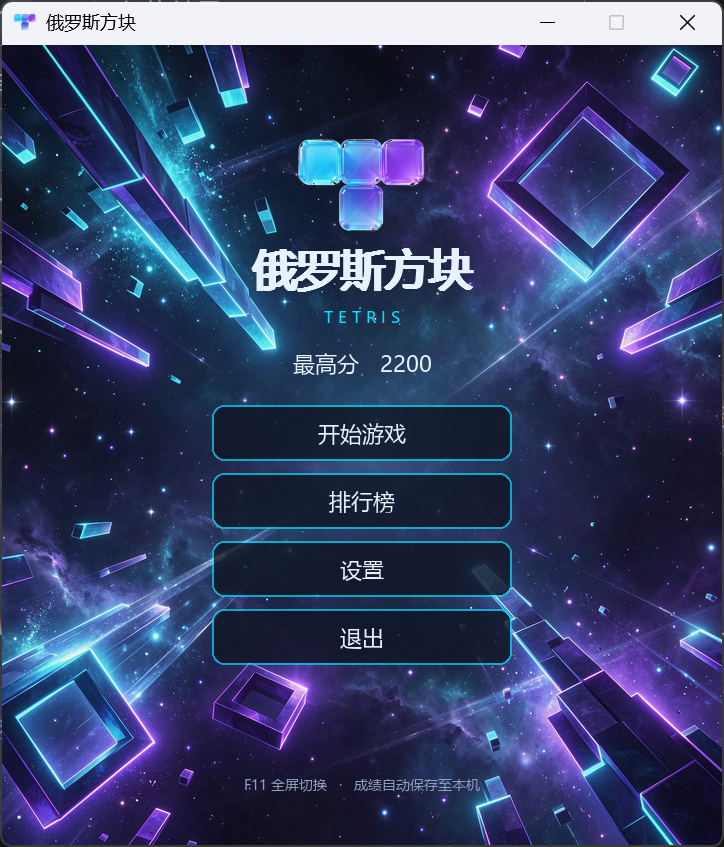
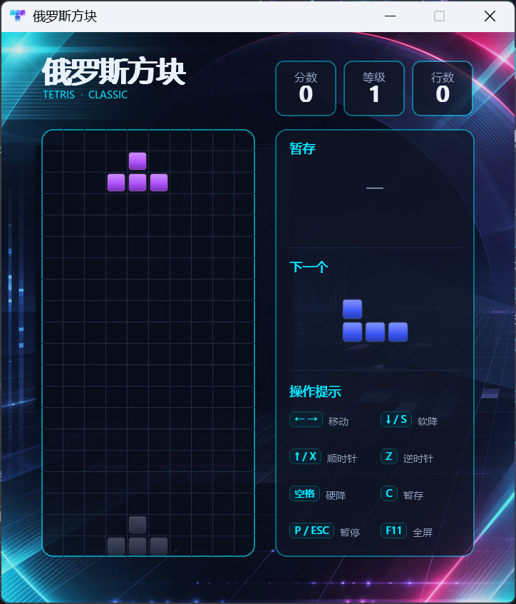
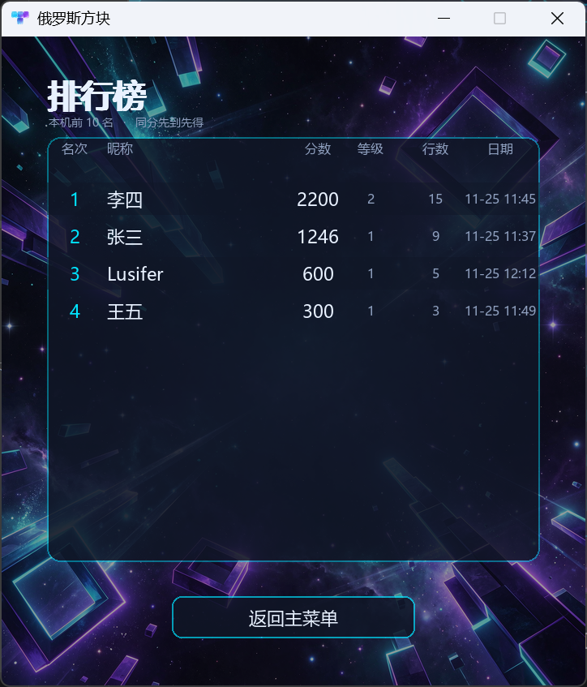

<p align="center">
  
</p>

<h1 align="center">俄罗斯方块</h1>

<p align="center">
  
  
  
  
  <br/>

一个基于 **Python 3 + pygame** 实现的俄罗斯方块桌面游戏

---

## 一、项目速览

| 项目 | 说明 |
| --- | --- |
| 产品名称 | 俄罗斯方块（Tetris）桌面版 |
| 英文名 | Tetris Desktop |
| 运行形态 | Windows 桌面窗口程序（Python 脚本 ／ exe 可执行文件） |
| 技术栈 | Python 3.12（conda `game` 环境）/ pygame 2.5+ / PyInstaller 6.x |
| 核心玩法 | 10×20 棋盘，七种方块，SRS 旋转、7-bag 随机、消行计分与等级加速 |
| 代码规模 | 规划约 2200 行（含测试与注释） |
| 交付物 | 源码工程、8 篇文档、素材包、单个 `俄罗斯方块.exe` |

## 二、文档索引

建议按序号阅读；只想快速跑起来，看第 4、6、7 篇即可。

| 序号 | 文档 | 内容 | 主要读者 |
| --- | --- | --- | --- |
| 01 | [需求规格说明书](docs/01-需求规格说明书.md) | 功能需求、非功能需求、界面需求、验收标准、需求边界 | 产品／讲师／开发 |
| 02 | [概要设计说明书](docs/02-概要设计说明书.md) | 总体架构、分层依赖、模块划分、运行时模型、数据流 | 开发 |
| 03 | [详细设计说明书](docs/03-详细设计说明书.md) | 常量、SRS 踢墙表、碰撞与消行、计分、渲染、音频、主循环 | 开发 |
| 04 | [开发规范与环境搭建](docs/04-开发规范与环境搭建.md) | 环境准备、依赖、命名与代码规范、开发节奏、排错 | 开发 |
| 05 | [测试计划与测试用例](docs/05-测试计划与用例.md) | 测试策略、单元用例、界面用例、性能与打包冒烟 | 开发／测试 |
| 06 | [打包发布指南](docs/06-打包发布指南.md) | PyInstaller 全流程、资源与音频收集、体积与误报排查 | 开发／发布 |
| 07 | [用户操作手册](docs/07-用户操作手册.md) | 安装、操作、计分规则、玩法思路、常见问题 | 最终用户 |
| 08 | [素材清单与制作说明](docs/08-素材清单与制作说明.md) | 图片/音频清单、规格、触发时机、生成脚本、换皮指南 | 美术／开发／发布 |

## 三、工程目录结构

```
俄罗斯方块/
├── main.py                 # 入口：初始化、界面状态机、主循环
├── requirements.txt        # 依赖清单
├── pytest.ini              # pytest 路径配置
├── tetris.spec             # PyInstaller 打包配置
├── version_info.txt        # exe 版本信息
├── assets/
│   ├── icon.ico            # exe 图标（16～256 多尺寸）
│   ├── icon.png            # 窗口图标（256×256）
│   ├── fonts/msyh.ttc      # 随包中文字体（18.8 MB）
│   ├── images/
│   │   ├── bg_menu.png     # 主菜单背景 720×800
│   │   ├── bg_game.png     # 游戏背景 720×800
│   │   ├── logo.png        # 标题徽标 512×512 透明底
│   │   └── blocks.png      # 方块贴图带 8×64 px
│   └── audio/              # BGM + 9 个音效（10 个 WAV）
├── src/
│   ├── config.py           # 尺寸、配色、速度表、计分表、DAS/ARR
│   ├── pieces.py           # 七种方块、SRS 旋转与踢墙、7-bag
│   ├── board.py            # 地形、碰撞、锁定、消行
│   ├── game.py             # 对局状态机、重力、锁定延迟、计分
│   ├── storage.py          # 最高分/设置/排行榜持久化
│   ├── resource.py         # 资源路径解析（兼容 exe）
│   ├── audio.py            # BGM 与音效、音量、无声卡降级
│   └── ui/
│       ├── theme.py        # 配色、字号、布局坐标
│       ├── renderer.py     # 棋盘/面板/菜单/设置/排行榜绘制
│       ├── effects.py      # 消行闪烁、Tetris 抖动、落点高亮
│       └── display.py      # 窗口/全屏与坐标映射
├── tools/
│   ├── gen_sprites.py      # 生成背景/Logo/图标/贴图带
│   └── gen_audio.py        # 生成全部音频
├── tests/
│   ├── test_pieces.py
│   ├── test_board.py
│   ├── test_game.py
│   └── test_storage.py
├── docs/                   # 本文档集
└── screenshots/            # 运行截图（开发完成后补充）
```

## 四、快速开始

```bash
# 1. 安装依赖
python -m pip install -r requirements.txt

# 2. 运行
python main.py

# 3. 跑单元测试（可选）
pytest -q

# 4. 重新生成素材（可选，需 pillow / numpy）
python tools/gen_sprites.py
python tools/gen_audio.py

# 5. 打包成单文件 exe
pyinstaller tetris.spec --clean --noconfirm
# 产物：dist/俄罗斯方块.exe
```

## 五、操作方式

| 按键 | 作用 |
| --- | --- |
| ← → / A D | 左右移动（DAS 170 ms，之后每 40 ms 一格） |
| ↓ / S | 软降（不额外加分） |
| ↑ / X | 顺时针旋转（SRS + 踢墙） |
| Z | 逆时针旋转 |
| 空格 | 硬降（不额外加分） |
| C | 暂存 / 交换（每块一次） |
| P / ESC | 暂停 / 继续 |
| F11 | 窗口 / 全屏 |

## 六、素材一览

| 类型 | 内容 | 规格 |
| --- | --- | --- |
| 背景 | `bg_menu.png`、`bg_game.png` | 720×800 PNG |
| 徽标 | `logo.png` | 512×512 透明底 |
| 方块 | `blocks.png` | 8 格 × 64 px 贴图带（I/J/L/O/S/T/Z + 幽灵） |
| 图标 | `icon.png`、`icon.ico` | 256×256 PNG + 七尺寸 ICO |
| 字体 | `msyh.ttc` | 随包中文，避免方块字 |
| 音乐 | `bgm_main.wav` | 31 秒原创芯片音乐，可循环 |
| 音效 | `sfx_*.wav` × 9 | 移动/旋转/锁定/消行/四行/升级/结束/菜单/暂停 |

素材全部由 `tools/` 下的脚本生成，规格、索引、触发时机与替换规则见 [08-素材清单与制作说明](docs/08-素材清单与制作说明.md)。

## 七、游戏截图

<p align="center">
  
</p>

<p align="center">
  
</p>

<p align="center">
  
</p>
